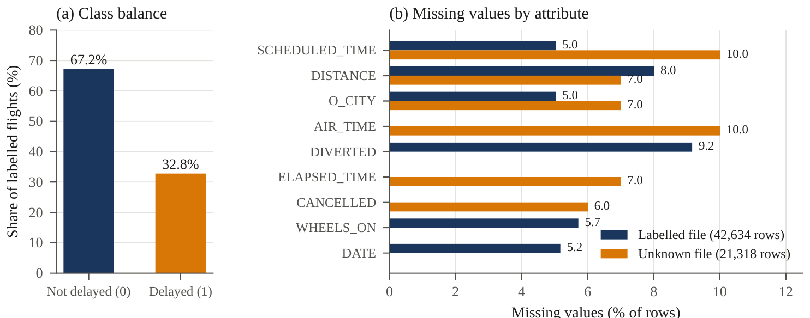
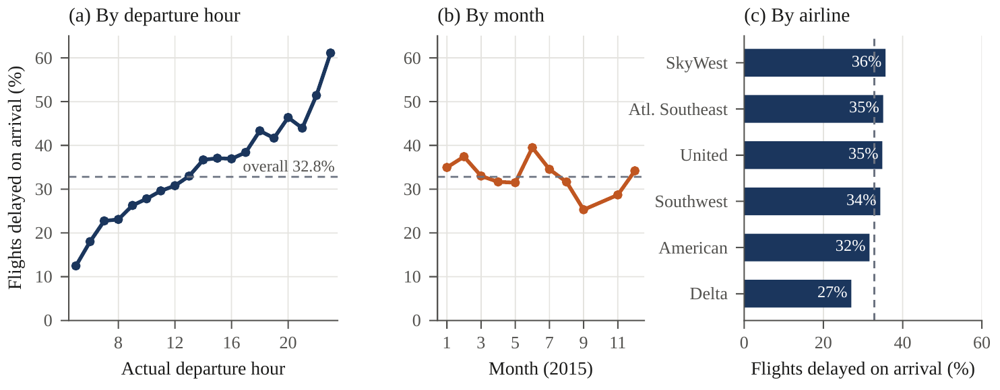
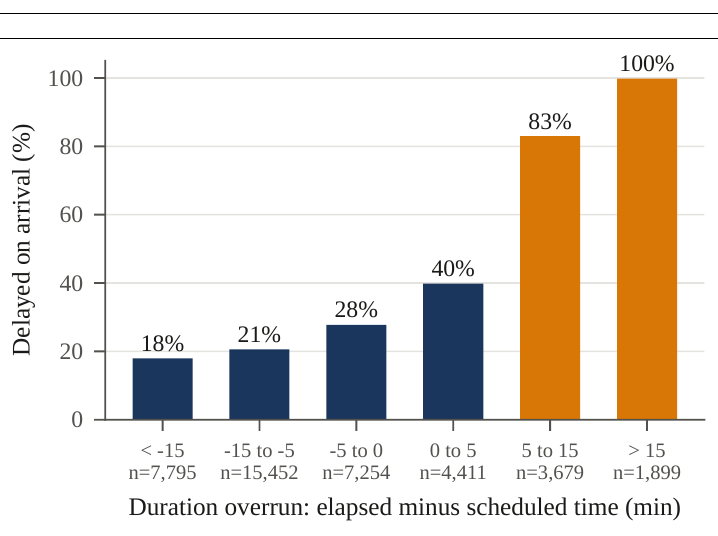
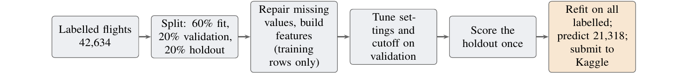
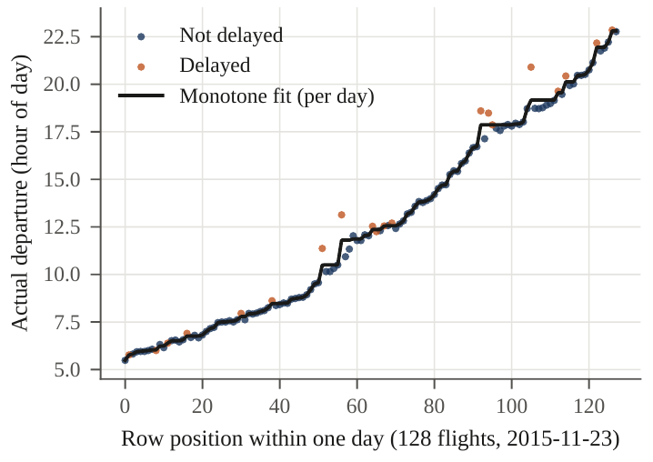
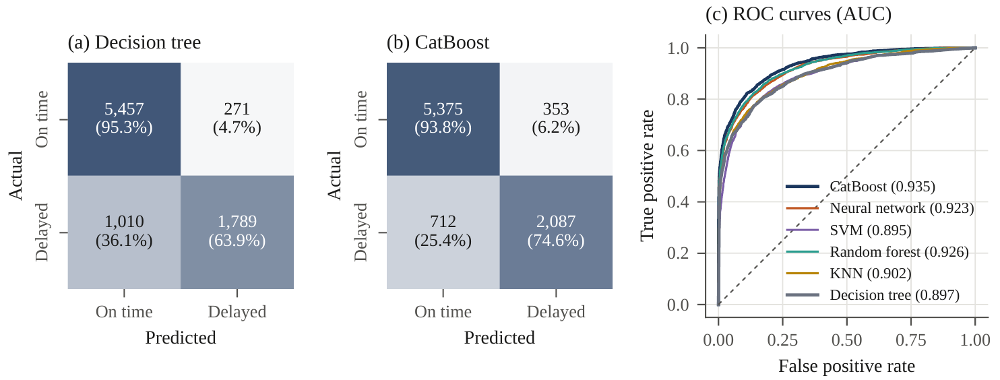
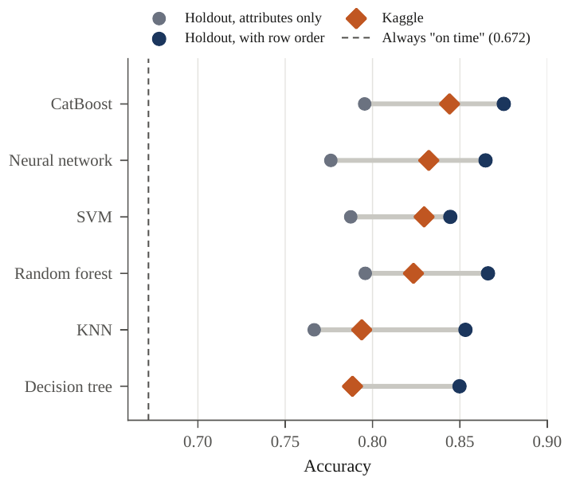
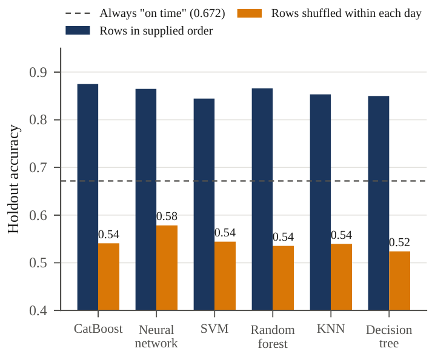
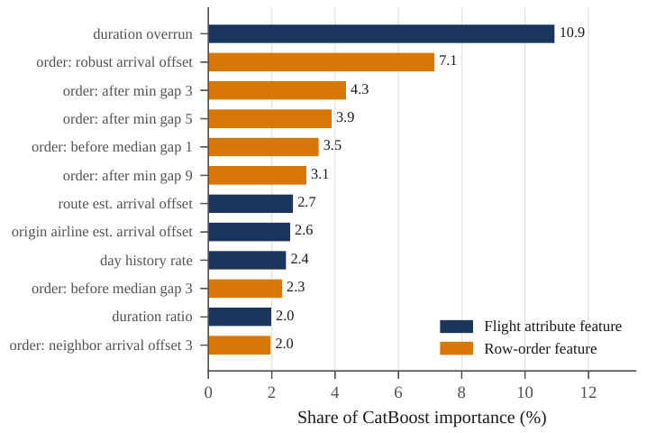
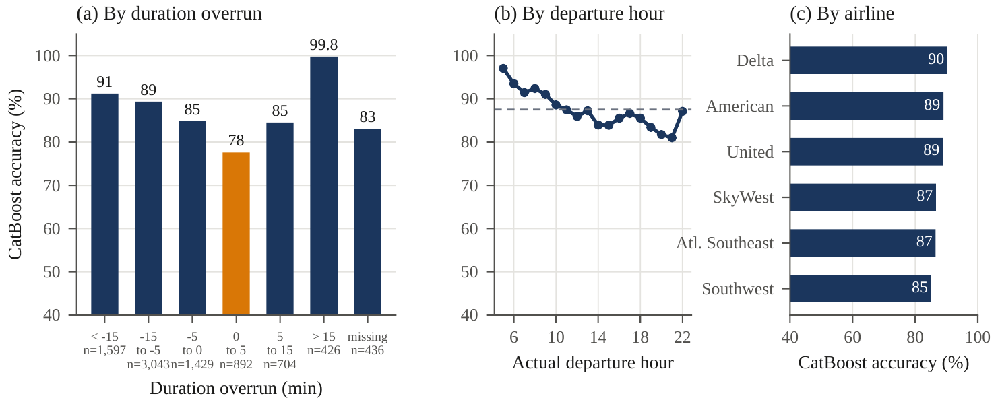

# Predicting Flight Arrival Delay with Six Classifiers

Binary classification of whether a flight **arrived late**, built for
a university data analytics assignment (Kaggle class competition).
Six models are compared under one evaluation protocol: decision tree, random forest, KNN,
SVM, neural network and CatBoost.

**Author:** Ridhima Singhal · **Full write-up:** [`report/report.pdf`](report/report.pdf)

## Results at a glance

| Model | Holdout accuracy | Kaggle accuracy | Holdout accuracy, attributes only* |
|---|---:|---:|---:|
| **CatBoost** | **0.8751** | **0.8441** | 0.7955 |
| Neural network | 0.8647 | 0.8322 | 0.7761 |
| SVM (RBF) | 0.8579 | 0.8295 | 0.7875 |
| Random forest | 0.8661 | 0.8234 | 0.7958 |
| KNN | 0.8532 | 0.7938 | 0.7666 |
| Decision tree | 0.8498 | 0.7885 | 0.7890 |
| *Always predict "on time"* | *0.6717* | – | – |

\*Same model type rebuilt **without** any row-order feature (see below). These are different
builds scored on different flights, so read them as a rough comparison between model types.

### Two things to know before reading the numbers

1. **The best models lean on the row order of the data file.** The flights inside each day are
   stored in time order, and the models exploit that: 32 "row-order" features carry about
   42% of CatBoost's feature importance. If the rows are shuffled within each day, every
   submitted model drops to **0.52–0.58 accuracy**, below the 0.6717 baseline. These models
   score well on *this* file but cannot score a single flight on its own and are not a general
   flight-delay predictor. The attribute-only column is the fairer measure of what the flight
   attributes alone give: about 0.77–0.80 accuracy.
2. **The task labels a delay that has almost happened.** `ELAPSED_TIME`, `AIR_TIME`,
   `WHEELS_ON` and `TAXI_IN` are only known at or near landing, and the scheduled departure
   time (hence the departure delay) is not in the data. These are not forecasts made before
   departure.

More limitations are listed [below](#limitations).

## Contents

- [The problem and the data](#the-problem-and-the-data)
- [Method](#method)
- [Results in detail](#results-in-detail)
- [Model settings](#model-settings)
- [Limitations](#limitations)
- [Repository layout](#repository-layout)
- [Reproducing the results](#reproducing-the-results)
- [References](#references)

## The problem and the data

The course supplies three files (not included in this repository, see [`data/`](data/README.md)):

| File | Rows | Contents |
|---|---:|---|
| Flight dataset | 42,634 | 15 attributes + target `Arrival_Delay` (0 = not delayed, 1 = delayed) |
| Unknown dataset | 21,318 | the same 15 attributes, target hidden; predictions go to Kaggle |
| Kaggle submission sample | 21,318 | the required format: columns `row ID`, `Predicted_Arrival_Delay` |

The attributes describe the route (origin/destination city and state), the time (`DATE`, actual
`DEPARTURE_TIME`), the duration (`SCHEDULED_TIME`, `ELAPSED_TIME`, `AIR_TIME`), the landing
(`WHEELS_ON`, `TAXI_IN`), `DISTANCE`, two status flags and the airline. The flights involve
6 airlines, 265 origin cities and 268 destination cities.



*About one flight in three is delayed (67.2% on time, 32.8% delayed). The labelled and unknown
files are missing **different** attributes, so missing values are repaired before modelling.*



*Delay rate by departure hour (12.5% at 5 am to 61.1% at 11 pm), month and airline.*

**The central difficulty.** Arrival delay equals departure delay plus the duration overrun
(`ELAPSED_TIME − SCHEDULED_TIME`). The data provide the overrun but not the departure delay.



*99.8% of flights that took more than 15 minutes longer than scheduled were delayed, but flights
within ±15 minutes of schedule are hard to call.*

## Method



**Evaluation protocol** (fixed before any tuning)
- 20% stratified **holdout** (8,527 flights), scored once, after every choice was made.
- The remaining 34,107 flights are split again: 25,580 for fitting and 8,527 for **validation**
  (a 60/20/20 split). Settings and decision cutoffs were chosen on validation accuracy.
- 5-fold cross-validation grouped by day (`GroupKFold` on `DATE`) as a check on the single split.
- Metrics: accuracy first (what Kaggle scores), plus precision, recall and F1 for the delayed
  class, weighted F1, ROC AUC, Brier score and expected calibration error.

**Preprocessing and features** (every rule is fitted on training rows only)
- *Missing values:* route-level medians for `SCHEDULED_TIME` and `DISTANCE`; `ELAPSED_TIME`,
  `AIR_TIME` and `WHEELS_ON` rebuilt from each other with inferred time-zone offsets; flag
  columns record what was repaired. Constant columns (`DIVERTED`, `CANCELLED`) are dropped.
- *Flight features:* cyclical clock times, duration overrun and ratio, ground time, estimated
  taxi-out, air speed, comparisons with route medians, calendar fields.
- *Cross-fitted history:* smoothed delay rates by day, origin, destination, airline, route and
  time block, computed with 5-fold cross-fitting so no row sees its own label.
- *Row-order context:* for each day, a monotone (isotonic) curve of departure time against row
  position; a flight sitting above the curve left later than its neighbours in the file.



*Delayed flights (orange) sit above the monotone fit more often than on-time flights.*

**Leakage guards:** label-based rates are cross-fitted; the holdout is scored once; no label
from the hidden file is ever used. The row-order features use no label, but they do use
position in the file, which is why every model is reported with and without them and why a
shuffle control is included.

## Results in detail

Holdout results on 8,527 flights, plus the Kaggle score on the 21,318 hidden flights. Precision,
recall and F1 are for the delayed class. Brackets are 95% bootstrap intervals.

| Model | Holdout accuracy [95% CI] | Precision | Recall | F1 | Weighted F1 | ROC AUC | Brier ↓ | Kaggle |
|---|---|---:|---:|---:|---:|---:|---:|---:|
| CatBoost | **0.8751** [0.868, 0.882] | 0.855 | **0.746** | **0.797** | **0.873** | **0.935** | **0.0891** | **0.8441** |
| Neural network | 0.8647 [0.857, 0.871] | 0.862 | 0.699 | 0.772 | 0.861 | 0.923 | 0.0964 | 0.8322 |
| SVM | 0.8579 [0.851, 0.865] | 0.835 | 0.707 | 0.766 | 0.855 | 0.912 | – | 0.8295 |
| Random forest | 0.8661 [0.858, 0.873] | **0.882** | 0.683 | 0.770 | 0.861 | 0.926 | 0.0945 | 0.8234 |
| KNN | 0.8532 [0.845, 0.861] | 0.861 | 0.659 | 0.747 | 0.847 | 0.902 | 0.1041 | 0.7938 |
| Decision tree | 0.8498 [0.842, 0.857] | 0.868 | 0.639 | 0.736 | 0.843 | 0.897 | 0.1065 | 0.7885 |

The SVM has no Brier score because its output is a sigmoid of the margin, not a calibrated
probability. A paired McNemar test separates CatBoost from every other model (p < 0.001 on this
holdout); the random forest and neural network cannot be separated from each other (p = 0.60).



*(a, b) Confusion matrices for the simplest and the best model; (c) ROC curves. Precision is
higher than recall for every model because cutoffs were chosen to maximise accuracy, not to
catch as many delays as possible.*
*Note: in panel (c) the SVM legend reads 0.895, but the SVM's ROC AUC is 0.912 (as in the table
above and as printed in notebook 04). The other five values match.*

### Validation, holdout and Kaggle side by side

| Model | Validation | Holdout | Kaggle | Gap (holdout − Kaggle, points) | Rank holdout / Kaggle |
|---|---:|---:|---:|---:|:---:|
| CatBoost | 0.8726 | 0.8751 | 0.8441 | 3.10 | 1 / 1 |
| Neural network | 0.8617 | 0.8647 | 0.8322 | 3.25 | 3 / 2 |
| SVM | 0.8647† | 0.8579 | 0.8295 | 2.84 | 4 / 3 |
| Random forest | 0.8635 | 0.8661 | 0.8234 | 4.27 | 2 / 4 |
| KNN | 0.8514 | 0.8532 | 0.7938 | 5.94 | 5 / 5 |
| Decision tree | 0.8467 | 0.8498 | 0.7885 | 6.13 | 6 / 6 |

†SVM validation is 3-fold cross-validation accuracy with values hidden to match the hidden file
(0.8682 without hiding).

Every model scored lower on Kaggle than on the holdout, by 2.8 to 6.1 points, and the middle
three models swapped places (Spearman rank correlation 0.83). A single holdout was not a safe
guide.



*Grey: holdout accuracy with attributes only. Blue: holdout accuracy with row-order features.
Orange diamond: Kaggle. The row-order signal carries over to Kaggle only in part.*



*Shuffling rows within each day collapses every submitted model to 0.52–0.58, below the
"always on time" line. Models built without row order did not change at all when shuffled.*

### What CatBoost relies on and where it errs



*The duration overrun is the top feature (10.9%); orange bars are row-order features.*



*CatBoost was right on 425 of 426 flights that took more than 15 minutes over schedule. Its
weakest group is flights 0–5 minutes over (77.6%), where the outcome depends on how late the
flight left, the part the attributes do not contain.*

## Model settings

Cutoffs are applied to the predicted probability (for the SVM, to a sigmoid of the decision
value). Build A and Build B are the two shared feature builds; the SVM uses its own focused
30-feature build.

| Model | Features | Final settings | Cutoff | Candidates compared | 5-fold day-grouped CV |
|---|---|---|---:|---|---:|
| Decision tree | Build A | entropy, max depth 10, ≥ 50 flights per leaf | 0.570 | 4 | 0.8431 ± 0.0052 |
| Random forest | Build A | 200 trees, max depth 14, ≥ 20 per leaf, 30% of features per split | 0.510 | 3 | 0.8612 ± 0.0041 |
| KNN | Build B | k = 60, distance-weighted, Manhattan, 16 features | 0.455 | 9 | 0.8489 ± 0.0048 |
| SVM | Focused | RBF, C = 1, γ = 0.03, 30 features, robust scaling | 0.490 | 12 screened, 3 shortlisted | – |
| Neural network | Build A | layers 64-32, ReLU, L2 0.1, lr 0.001, batch 512, early stopping, 5 seeds averaged | 0.530 | earlier search | 0.8594 ± 0.0045 |
| CatBoost | Build A | depth 7, 945 trees, lr 0.03, L2 leaf reg. 10, category interactions up to 2 | 0.485 | 3 | 0.8724 ± 0.0038 |

KNN, SVM and the neural network use scaled inputs (quantile or robust scaling) with
target-encoded categories; the tree models and CatBoost need no scaling.

## Limitations

These are also set out in Section 8 of the report.

1. **Dependence on file order.** The submitted models cannot score a single flight and collapse
   when rows are shuffled. Their Kaggle scores are valid for this hidden file, not evidence of a
   general delay predictor.
2. **One split.** All holdout figures come from a single 20% sample; with 8,527 flights the
   standard error of an accuracy near 0.86 is about 0.4 points, so models with overlapping
   intervals cannot be ranked from it.
3. **Kaggle used to pick versions.** For the SVM, KNN and neural network I kept the version with
   the higher Kaggle score. Settings and cutoffs were set on validation, but the three Kaggle
   scores are slightly optimistic.
4. **Unexplained holdout-to-Kaggle gap.** Hiding values to match the hidden file's missing rates
   explained only 0.35 points of CatBoost's 3.1-point gap; a density check explained none.
5. **Uneven comparison.** The models use different feature builds and had different amounts of
   tuning, so the ranking mixes model type with the pipeline around it.
6. **Accuracy-tuned cutoffs.** Recall on the delayed class is lower than it could be. An airline
   that cared more about missed delays than false alarms would choose a lower cutoff.

## Repository layout

```
.
├── README.md
├── requirements.txt
├── notebooks/            one self-contained notebook per model
│   ├── 01_decision_tree.ipynb
│   ├── 02_knn.ipynb
│   ├── 03_random_forest.ipynb
│   ├── 04_svm.ipynb
│   ├── 05_neural_network.ipynb
│   └── 06_catboost.ipynb
├── report/               full write-up (PDF)
├── docs/figures/         figures used in this README, taken from the report
└── data/                 put the three course CSV files here (not tracked, see data/README.md)
```

Each notebook builds its own features, so none depends on another notebook or on a custom
`.py` file. Output file names: `decision_tree.csv`, `knn1.csv`, `random_forest.csv`,
`svm1.csv`, `neural_network1.csv` and `catboost.csv`.

## Reproducing the results

1. Install the dependencies (Python 3.11 or newer):

   ```bash
   python -m venv .venv
   source .venv/bin/activate          # Windows: .venv\Scripts\activate
   pip install -r requirements.txt
   ```

2. Copy the three course CSV files into `data/` (see [`data/README.md`](data/README.md)).
3. Open a notebook from `notebooks/` in Jupyter or VS Code and **Run All**. The last cell trains
   on all labelled flights and writes the model's prediction CSV next to the flight CSV, in
   `data/`. Runtimes are several minutes per notebook; the neural network takes about fifteen.

Random seeds are fixed in the notebooks (the splits use `random_state` 42 and 17). Results can
still differ slightly across library versions, which is why `requirements.txt` pins the versions
named in the notebooks' own install cells.

## References

1. Breiman, L. (2001). Random forests. *Machine Learning*, 45(1), 5–32.
2. Prokhorenkova, L., Gusev, G., Vorobev, A., Dorogush, A. V., and Gulin, A. (2018). CatBoost:
   unbiased boosting with categorical features. *NeurIPS 31*.
3. Grinsztajn, L., Oyallon, E., and Varoquaux, G. (2022). Why do tree-based models still
   outperform deep learning on typical tabular data? *NeurIPS 35*.
4. Vaswani, A., et al. (2017). Attention is all you need. *NeurIPS 30*.

---

*The datasets were provided for the university assignment and are not redistributed here. The Kaggle
competition was private to the class; its scores are reported for reference.*
